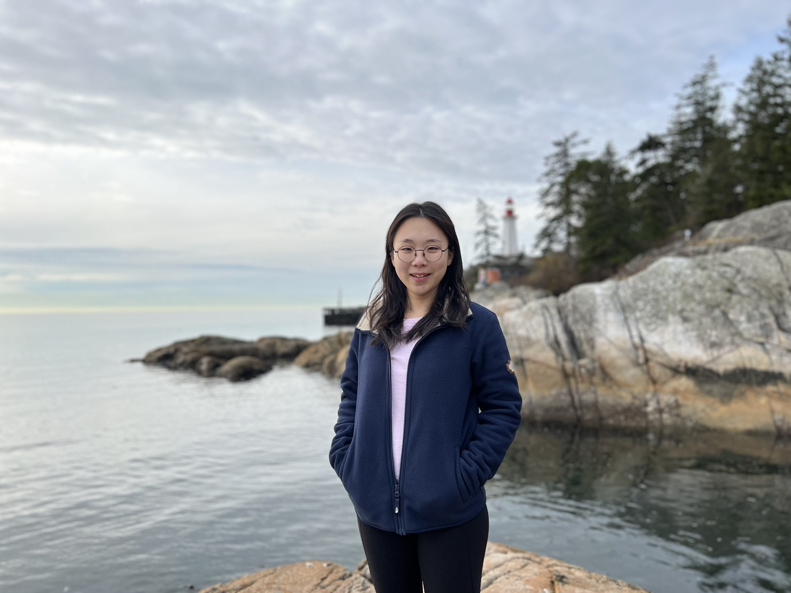

Welcome! I am a Postdoctoral Research Fellow at the Niehaus Center for Globalization and Governance at Princeton University. I received my Ph.D. in Political Science from the University of Washington in June 2026.

I study authoritarian global governance: how autocrats use international law, how they build international organizations, and whether their rhetoric persuades the public. My work combines text analysis, Bayesian measurement of international organizations, and survey experiments. My book project, *Sovereignty as Shield: How Authoritarian States Use International Law*, draws on in-depth studies of China and Southeast Asia.

I earned my B.A. in International Studies from Kyung Hee University, South Korea, in 2019.

Email: jihyeonb@princeton.edu |
My first name is pronounced "JEE-hee-on" 

