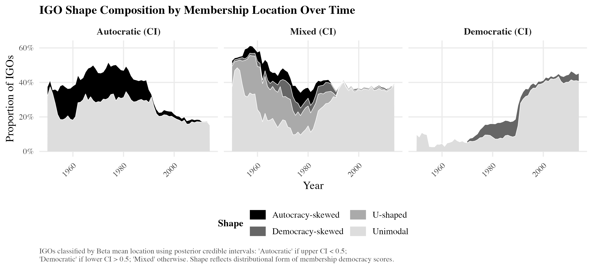

**[GeoNdxR](https://github.com/uwescience/WaterReuseDSSG2024)** is an R package that lets users build an interactive index website from their own geospatial data, with no server required. A live example is the [water reuse index](https://chayek.github.io/Water-Reuse-Drivers-Index/). I developed the package with a team in the University of Washington's Data Science for Social Good program (summer 2024).

## Measurement: Varieties of Intergovernmental Organization

*With Curtis Atkisson. Work in progress. Data available upon request.*

Studies of intergovernmental organizations (IGOs) usually describe an organization by the average democracy score of its members. That average cannot tell a uniformly hybrid IGO from one split between autocracies and democracies, and it is unstable when membership is small. We model member-state democracy scores (V-Dem polyarchy) as Beta-distributed and estimate the distribution's shape in a Bayesian framework for each IGO–year. The result is a probability that each organization is unimodal, U-shaped (polarized), democracy-skewed, or autocracy-skewed, rather than a single hard label. 

{width=80%}

A talk on the project is available [here](https://www.youtube.com/watch?v=K0KlXZxyu34&t=956s).

